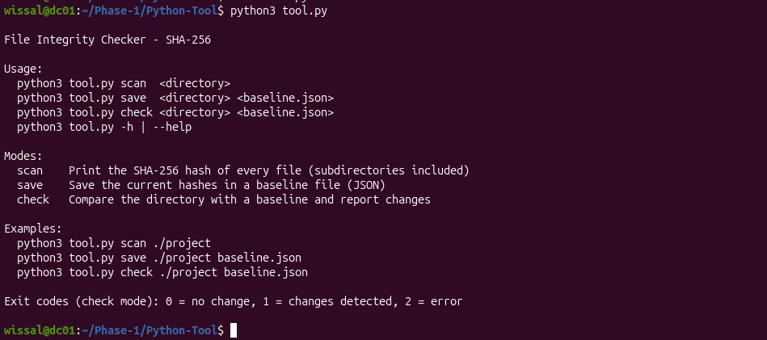
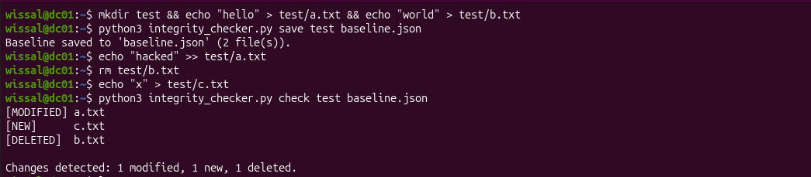

# File Integrity Checker (Python)

## Objective
Detect unauthorized changes in a directory using SHA-256 hashes.
The tool saves a trusted baseline of all file hashes, then compares the
directory against it later to report modified, new and deleted files
(basic File Integrity Monitoring).

## Features
- Computes the SHA-256 hash of every file, subdirectories included
- Files are read in 64 KB chunks, so large files do not fill the memory
- Three modes: `scan` (display hashes), `save` (create a JSON baseline),
  `check` (compare with the baseline)
- Reports `[MODIFIED]`, `[NEW]` and `[DELETED]` files
- Relative paths in the baseline: it still works if the folder is moved
- Error handling: invalid directory, unreadable files, missing or corrupted
  baseline, wrong arguments
- Exit codes for automation: `0` no change, `1` changes detected, `2` error
- Help option `-h` / `--help`

## Requirements
- Python 3 (tested on Ubuntu)
- Standard library only (`os`, `sys`, `json`, `hashlib`, `datetime`),
  no installation needed
- Read permission on the files to scan (`sudo` may be needed for system
  directories such as /etc)

## How to Run
```bash
chmod +x tool.py
python3 tool.py -h
python3 tool.py <mode> <directory> [baseline.json]
```

## Example Usage
```bash
# Display the hash of every file
python3 tool.py scan ./test

# Save a trusted baseline
python3 tool.py save ./test baseline.json

# Later: verify the directory against the baseline
python3 tool.py check ./test baseline.json
```

## Example Output
Help message:



Saving baseline and detecting changes :




## Challenges Faced
- Reading large files without loading them fully in memory
- Using relative paths so the baseline stays valid if the folder moves
- Continuing the scan when one file is unreadable (PermissionError)
- Separating the comparison logic from the display for cleaner code
- Fixing a bug where the function name was printed instead of the hash

## Limitations
- The baseline file itself can be modified by an attacker; it should be
  stored in a protected location or on another machine
- Only file content is checked (not permissions, owner or timestamps)
- A change between two checks is detected, but not who made it or when

## Future Improvements
- Option to exclude folders or extensions (e.g. `.git`, `*.log`)
- Verify the baseline itself with its own hash or a signature
- Also track permissions and ownership
- Export the report to a file (`-o` option)
- Run automatically with cron and send an alert by email
- Support other algorithms (SHA-512)
