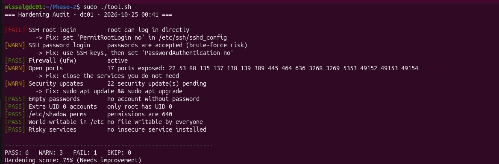
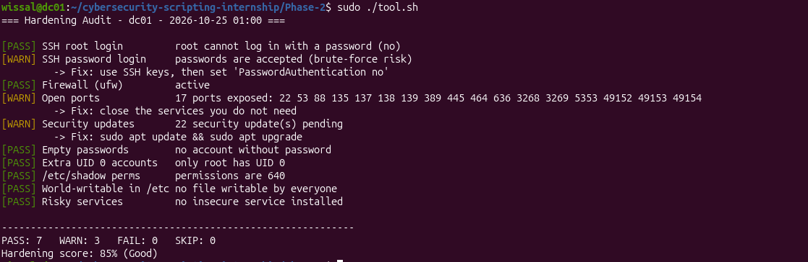

# Hardening Audit (Bash)

## Problem Statement
Newly deployed Linux servers often keep insecure default settings: root
login over SSH, no firewall, pending security updates, unnecessary open
ports. Full audit tools like Lynis are heavy for small teams or beginners.
This tool runs a quick, read-only check of the most critical hardening
points and gives a score with clear fixes.

## Objective
Give a fast and readable security snapshot of an Ubuntu/Debian machine,
inspired by the CIS Benchmarks, without changing anything on the system.

## Features
- 10 checks: SSH (root login, password login), firewall, open ports,
  security updates, empty passwords, extra UID 0 accounts, `/etc/shadow`
  permissions, world-writable files in `/etc`, risky services
- Result for each check: `PASS`, `WARN`, `FAIL` or `SKIP`
- A fix command shown for every problem found
- Final hardening score in percent
- Exit code `1` if a `FAIL` is found (usable in scripts or cron)
- Read-only: the tool never modifies the system
- Help option `-h` and error handling for wrong options

## Requirements
- Ubuntu or Debian, Bash
- Standard tools: grep, awk, sed, find, stat, ss, systemctl, dpkg, apt
- `sudo` for the full audit (e.g. reading `/etc/shadow`); without it,
  those checks are skipped

## How to Run
```bash
chmod +x tool.sh
./tool.sh -h
./tool.sh
sudo ./tool.sh
```

## Example Usage
```bash
# Basic audit
./tool.sh

# Full audit
sudo ./tool.sh

# Use the result in a script
sudo ./tool.sh > /dev/null && echo "No FAIL found"
```

## Example Output
Full test: audit with insecure settings, then after fixing them.




## Challenges Faced
- Reading SSH options correctly (main file and `sshd_config.d/`)
- Some checks need root: skipped cleanly instead of giving a wrong result
- Ignoring local-only ports (127.0.0.1) when listing open ports
- Keeping every check in its own function with the same output format

## Limitations
- Only Ubuntu/Debian (uses apt and dpkg)
- The update check depends on the local package list (`apt update`)
- Covers 10 basic checks, it is not a full compliance audit
- The firewall check looks at ufw only (not nftables or iptables)

## Future Improvements
- Export the report to a file or JSON (`-o` option)
- More checks (sudoers, password policy, auditd, kernel parameters)
- Option to run a single check
- Compare two audits to see what improved
- Run it with cron and send an alert by email
